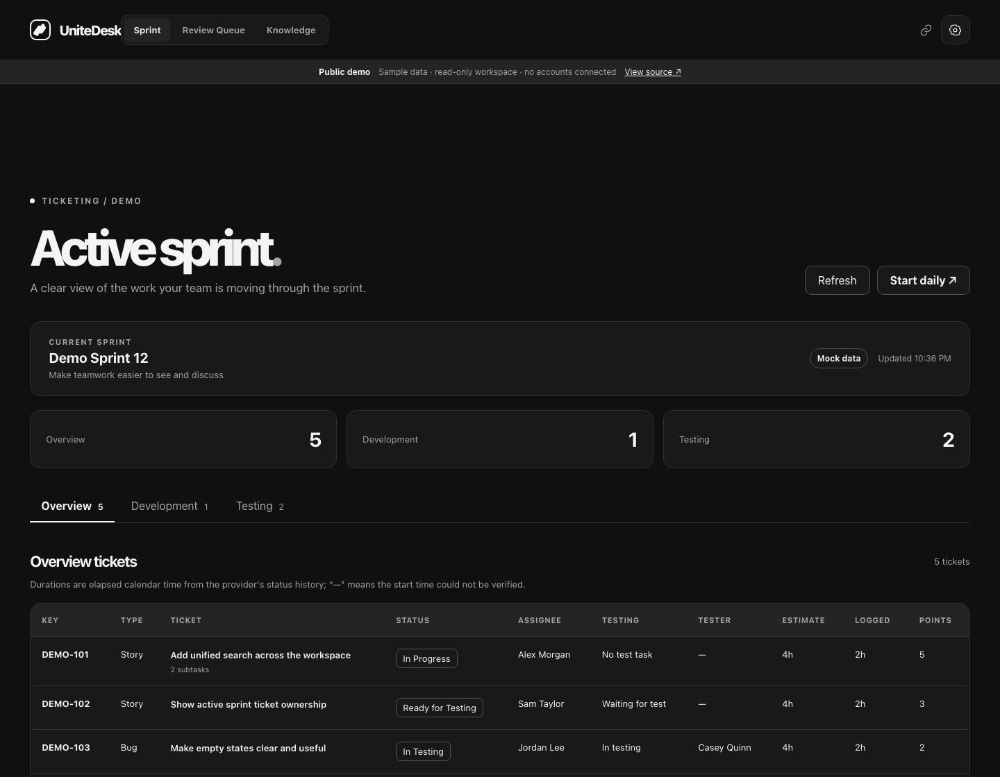
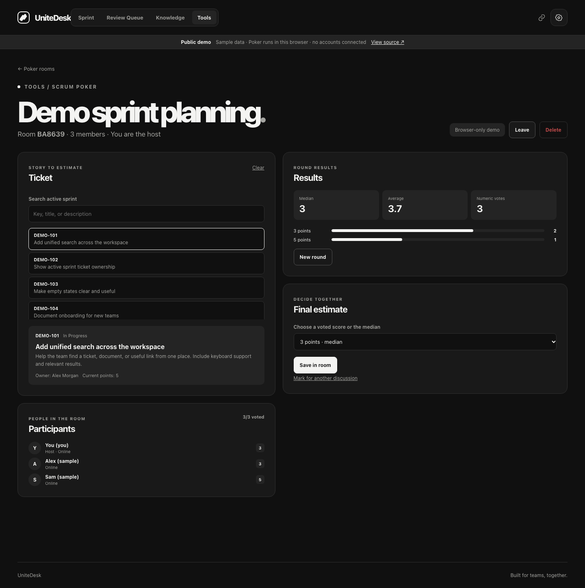
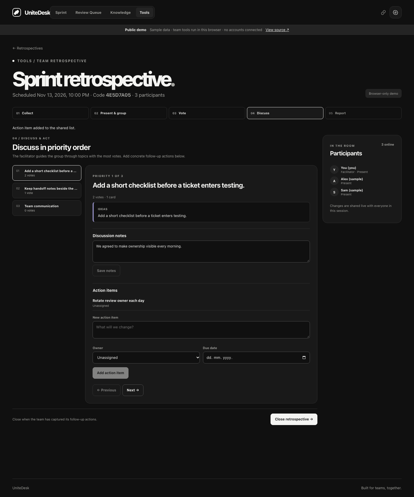

# UniteDesk ✦

**One clear view of the work your team does across its tools.**

[🌐 Try the live demo](https://nokibuzz.github.io/unitedesk/) · [📦 Developer Preview v0.1.0](https://github.com/nokibuzz/unitedesk/releases/tag/v0.1.0) · [📖 Connect your tools](docs/integrations.md) · [🤝 Contribute](CONTRIBUTING.md)

[](https://github.com/nokibuzz/unitedesk/actions/workflows/pages-demo.yml) 



UniteDesk brings active sprint work, code reviews, documentation, and team shortcuts into one workspace. Keep using the tools you already have: UniteDesk reads their data, organizes it for the team, and links back to the source. It is designed to be configurable for different teams instead of assuming one company's workflow.

> **Demo notice:** The [public demo](https://nokibuzz.github.io/unitedesk/) uses synthetic data. Scrum Poker and Team Retrospective run inside your browser; sessions are not shared with other visitors. Provider data remains read-only. No accounts, tokens, or private company links are included.

## ✨ What you can do today

| Area | Features | Sources |
| --- | --- | --- |
| 🎯 **Active sprint** | Overview, Development, and Testing views with owners, estimates, subtasks, testing tasks, and time in status | Jira, Linear, local mock data |
| 🗣️ **Daily mode** | Present one ticket at a time, read its description and linked work, then review a sprint recap | Jira, Linear, local mock data |
| 🔎 **Review Queue** | See open changes, your work, reviews waiting for you, aging requests, approvals, pipelines, and advanced filters | GitLab or GitHub |
| 📚 **Knowledge** | Browse document trees, search across sources, read a preview, and open the original page | Confluence, GitHub Markdown, Notion |
| 🃏 **Scrum Poker** | Create a room, choose an active sprint ticket, vote privately, reveal results, compare median and vote distribution, and save a final estimate | Jira, Linear, local mock data |
| 🔄 **Team Retrospective** | Schedule a session, collect private cards, group and present ideas, vote, discuss priorities, track actions, and export a PDF report | Shared local workspace; no external account required |
| 🔗 **Useful links** | Shared shortcuts with icons, keywords, and fuzzy search from every page (`Ctrl/⌘+K`) | Any HTTP or HTTPS URL |
| ⚙️ **Settings** | Light and dark themes, start page, team workflow rules, status mapping, and a GitLab or GitHub Review Queue connection | Browser and local server |

Scrum Poker can publish a confirmed story point estimate to a live Jira issue when the host explicitly chooses **Publish to Jira**. Other provider actions, code review approvals, and document editing are not yet implemented. The original tools remain the source of truth.

## 🚀 Try it

Open **[nokibuzz.github.io/unitedesk](https://nokibuzz.github.io/unitedesk/)**. Explore the sample sprint, start Daily mode, filter the Review Queue, search Knowledge, and open Useful links. Try **[Scrum Poker](https://nokibuzz.github.io/unitedesk/#/tools/poker)** or **[Team Retrospective](https://nokibuzz.github.io/unitedesk/#/tools/retro)** with sample teammates. The demo is hosted as a static GitHub Pages site; it does not need an API server.

### 📱 Add the demo to your phone

The public demo can be installed as a web app with the UniteDesk icon; there is no App Store or Play Store package. On Android, open the demo in Chrome and choose **⋮ → Install app** (or **Add to Home screen**). On iPhone, open it in Safari and choose **Share → Add to Home Screen**, then **Open as Web App** if offered. It launches from your home screen without a browser tab. The demo still uses synthetic data and needs an internet connection; installing it does not connect your Jira, GitLab, or other accounts. A local UniteDesk server must be reachable from the phone on a trusted network, and standard PWA installation outside localhost requires HTTPS.

To run your own workspace locally:

```bash
git clone https://github.com/nokibuzz/unitedesk.git
cd unitedesk
npm ci
npm run mock:seed
npm run dev
```

Open the web address printed by the development command. Node.js **22.12+** and npm **10+** are required. The ignored `mock/` folder contains editable Jira, GitLab, and Notion sample records. For a full local Knowledge sample, set `DOCUMENTATION_PROVIDERS=notion` and `NOTION_MODE=mock` in a private `.env` file copied from `.env.example`.

For a production-style local build, run `npm run build` and `npm start`. The server binds to `127.0.0.1` by default while authentication is unfinished. The public demo is built separately with `npm run build:demo` and published by [the Pages workflow](.github/workflows/pages-demo.yml).

### 🃏 Plan together with Scrum Poker

Open **Tools → Scrum Poker**, enter a display name, and create a room. Share its code or invite link with teammates running the same local server. The host chooses a ticket from the connected active sprint. Everyone picks a story point card; votes stay hidden until the host reveals them. The results show each vote, the distribution, average, and median. The host can mark a ticket for another discussion, start a new round, and save the agreed estimate in the room.

For teams that estimate time too, the host can enable optional **Development / QA hours** before voting starts. The host may publish a final story point value to Jira through a separate confirmation step. This requires a live Jira connection, issue edit permission, and a story point field on the board (`JIRA_STORY_POINTS_FIELD` can override its ID). Linear and mock tickets can be estimated in the room, without provider writeback. Live rooms are kept in server memory for 24 hours after the last activity; restarting the server clears them. The GitHub Pages demo simulates teammates in one browser and never writes to Jira.



### 🔄 Turn retrospectives into follow-up work

Set your team's columns and votes per person in **Settings → Retrospective**. A facilitator creates and schedules a session; the chosen defaults are saved with that session, so later setting changes do not alter an ongoing meeting. Participants can add cards before the meeting, finish their own input, and reopen it while collection is active. Other people's cards stay hidden until presentation.

On or after the scheduled date, the facilitator can start presentation once everyone **currently present** has finished. Contributors who added cards earlier but are absent do not block the meeting. The facilitator can group similar cards and guide a shared spotlight, then open voting. Each participant can distribute up to the configured vote count (five by default); totals appear when discussion starts. Topics are ordered by votes. The team can capture discussion notes and assign action items with optional due dates. Open actions from every retrospective stay in one list until someone marks them complete. Closing the session enables a PDF report with cards, ranked themes, notes, votes, and actions.



Live collaboration uses the same local server for everyone. To try it from several computers on a **trusted private LAN or VPN**, build once and start the server on the machine's network interface:

```bash
npm run build
HOST=0.0.0.0 npm start
```

Open `http://<server-lan-ip>:3001` on each computer, then share a retrospective's invite link or eight-character code. The server sends phase, grouping, presence, notes, and vote updates to every connected participant. Sessions and open actions are persisted in the ignored `data/retrospectives.json` file; keep it in your backup plan. The static GitHub Pages demo simulates participants in one browser and offers **Print / Save as PDF** through the browser's print dialog. The local server provides a direct PDF download.

## 🔌 Connect real tools

1. Follow [Connecting your tools](docs/integrations.md) to set up Jira or Linear and your documentation sources in a private `.env` file.
2. Open **Settings → Team → Code review source**. Choose **GitLab** or **GitHub**, enter its address, scope, and access token, then save. Review Queue uses the selected provider on the next visit. Existing `.env` values remain supported as defaults.
3. Review the suggested ticket status roles in **Settings → Team → Ticket status mapping**. Confirm them for your team's workflow.
4. Add your team's dashboards, logs, repositories, and deployment URLs under **Useful links**. Add keywords such as service and environment names so teammates can find them quickly.

GitHub Markdown documentation currently uses `GITHUB_TOKEN` from `.env` independently of the Review Queue connection. Credentials saved through Settings are stored in local `data/code-review-connection.json` with restricted file permissions; the API reports only whether a token exists and never returns its value. `.env`, `data/`, and `mock/` are excluded from Git.

## 🧩 How it is organized

```text
apps/
  api/           Express API, provider adapters, local configuration
  web/           React dashboard, settings, demo data source
docs/           Integration guide and demo screenshot
scripts/        Development, mock data, and integration checks
.github/         Static demo deployment workflow
```

Provider adapters normalize each tool's data into shared sprint, review, and document views. Scrum Poker uses the normalized active sprint tickets, so Jira, Linear, and mock data share the same voting flow. Retrospectives and their action items use local persistent storage and do not require a third-party account. The public demo uses a separate static data source, so no private local files are part of the Pages artifact.

## 🧪 Verify changes

```bash
npm test
npm run typecheck
npm run build
npm run build:demo
```

`npm run test:live` is available after you configure your own temporary test accounts. It checks configured integrations locally and does not print tokens.

## 🛡️ Project status and privacy

UniteDesk is an early open source project. It does **not** have user authentication yet. Keep the API on the default loopback address except for short-lived collaboration on a trusted LAN or VPN; do not expose it directly to the internet. Poker and retrospective sessions use browser guest cookies, which are suitable for local team testing but not public multi-tenant hosting. Use short-lived, least-privilege provider tokens and never commit them. The GitHub Pages demo contains only public sample data; its interactive tools are isolated to each browser.

PDF reports embed [Noto Sans](https://github.com/google/fonts/tree/main/ofl/notosans), distributed under the [SIL Open Font License](apps/api/assets/OFL.txt).

Planned work includes provider actions, safer multi-user authentication, easier connection setup, more integrations, and richer team workflows. See the repository issues to discuss what should come next.

## 🤝 Contributing

Ideas, bug reports, documentation, and code are welcome. Start with a [good first issue](https://github.com/nokibuzz/unitedesk/issues?q=is%3Aissue+is%3Aopen+label%3A%22good+first+issue%22) or read [CONTRIBUTING.md](CONTRIBUTING.md) before opening a pull request. See the [Code of Conduct](CODE_OF_CONDUCT.md) and [Security Policy](SECURITY.md). UniteDesk is released under the [MIT License](LICENSE).
